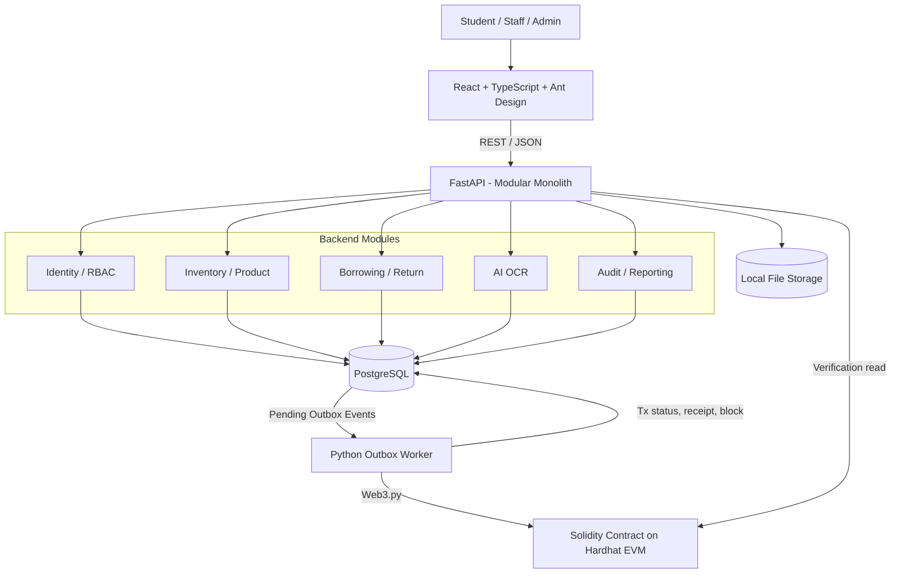
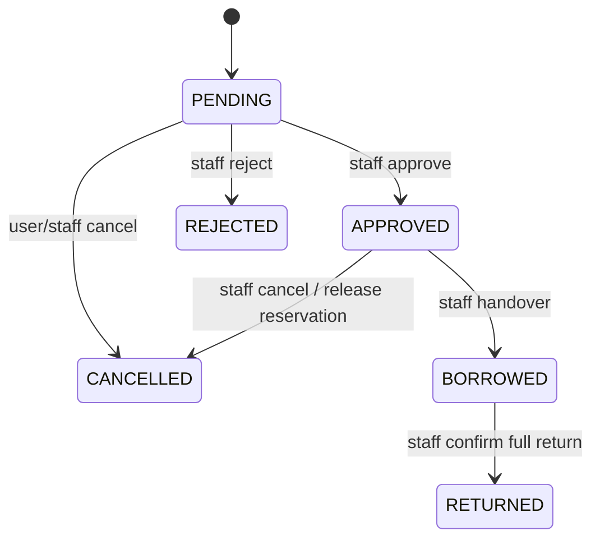
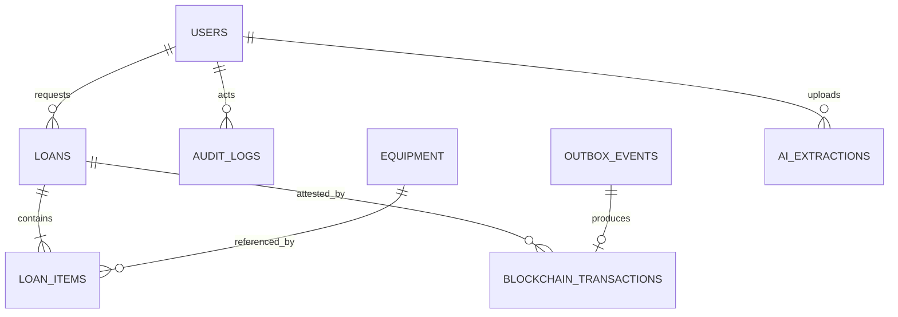

# LABCHAIN — PROJECT PLAN & AI IMPLEMENTATION SPECIFICATION

> **Purpose:** Đây là đặc tả nguồn sự thật (single source of truth) để AI coding agent triển khai dự án theo từng giai đoạn. Ngôn ngữ giao diện ưu tiên **tiếng Việt**; mã nguồn, tên bảng/cột/API, tài liệu kỹ thuật có thể dùng tiếng Anh.
>
> **Project:** LabChain — Hệ thống quản lý mượn/trả thiết bị phòng Lab/thư viện, tích hợp Blockchain và AI OCR.
>
> **Course mapping:** (1) Blockchain: smart contract, giao dịch, lịch sử xác minh. (2) Ngôn ngữ kịch bản: CRUD quản lý Product/Equipment đủ 11 chức năng, automation, import/export, OCR AI.
>
> **Status:** Bản kế hoạch để triển khai, **chưa phải mô tả các tính năng đã hoàn thành**. AI agent phải cập nhật checklist khi thực hiện.

---

## 0. Chỉ dẫn bắt buộc cho AI coding agent

1. Đọc toàn bộ `PROJECT_PLAN.md` trước khi tạo/sửa code. Nếu repository có sẵn, kiểm tra hiện trạng rồi điều chỉnh có kiểm soát; không ghi đè phá dữ liệu.
2. Triển khai **từng phase**, ưu tiên MVP chạy được end-to-end. Không tự ý đổi stack hoặc thêm microservices, Kafka, Redis, Kubernetes, Elasticsearch, IPFS.
3. Mỗi phase phải: (a) giải thích thay đổi, (b) code chạy được, (c) thêm test, (d) chạy lint/test/migration/build phù hợp, (e) cập nhật README và checklist. Không báo “đã xong” khi chưa kiểm chứng.
4. Nếu yêu cầu chưa được định nghĩa rõ, dùng **default decisions** trong tài liệu này. Chỉ hỏi người dùng khi quyết định liên quan trực tiếp đến chính sách trường/lớp hoặc thông tin bí mật không thể tự quyết.
5. Không hardcode private key, mật khẩu, API key. Dùng `.env.example`, `.env` (gitignored), Docker secrets hoặc biến môi trường. Không đưa PII lên blockchain.
6. Đối với mọi chức năng, ưu tiên tính đúng nghiệp vụ, bảo mật, kiểm tra dữ liệu, xử lý lỗi, tính nhất quán và test trước UI cầu kỳ.
7. Dùng phiên bản dependency ổn định, tương thích, được kiểm tra tại thời điểm triển khai; pin versions trong lockfiles. Tránh giả định rằng tất cả phiên bản mới nhất tương thích nhau.
8. Khi AI agent triển khai trong môi trường không có Internet hoặc không thể cài dependency: vẫn tạo code, migration, test, tài liệu và ghi rõ bước nào chưa chạy được — **không bịa kết quả**.
9. Không tự deploy testnet/mainnet và không chi tiền/gas thật; dev mặc định dùng Hardhat local chain.
10. Mỗi khi hoàn thành phase, cập nhật phần **Progress tracker** ở cuối tài liệu này.

## 1. Mục tiêu, phạm vi, user stories

### 1.1 Mục tiêu

- Xây dựng web quản lý thiết bị có thể mượn/trả, có đăng nhập và phân quyền.
- Hoàn thành **11 yêu cầu module quản lý Product** của môn Ngôn ngữ kịch bản.
- Lưu và xác minh một phần lịch sử duyệt mượn, trả bằng smart contract EVM, không thay thế database.
- Tích hợp **AI thực tế**: OCR trích thông tin nhãn thiết bị từ ảnh, có bước người dùng kiểm duyệt.
- Chạy được trên Linux bằng Docker Compose; có dữ liệu demo và tài liệu trình diễn riêng cho từng môn.

### 1.2 Roles

- **Student/User:** xem thiết bị, tìm kiếm, tạo yêu cầu mượn, xem phiếu của bản thân, xem lịch sử và xác minh on-chain của phiếu mình có quyền xem.
- **Staff/Lab Manager:** quản lý thiết bị, phê duyệt/từ chối, bàn giao/nhận trả, xem báo cáo và lịch sử theo phạm vi quyền.
- **Admin:** phân quyền tài khoản, toàn quyền vận hành nghiệp vụ, cấu hình hệ thống demo (không tiết lộ secrets trên UI).

### 1.3 In-scope MVP

1. Auth + role-based access control (RBAC) + user seeding.
2. Inventory/Product CRUD **đủ 11 chức năng**.
3. Borrow/Return workflow, kiểm soát số lượng tồn kho nhất quán.
4. PostgreSQL + migrations.
5. Solidity smart contract ghi hash sự kiện mượn/trả; Hardhat local; Web3.py bridge.
6. Transactional outbox + worker để đồng bộ Blockchain, kiểm tra receipt, retries idempotent.
7. AI OCR hỗ trợ điền biểu mẫu thiết bị từ hình ảnh; có xác nhận thủ công.
8. Docker Compose, unit/integration tests, seed demo data, README.

### 1.4 Out-of-scope v1

- Tiền đặt cọc/thu phí, thanh toán tiền mã hóa, token/NFT.
- Blockchain lưu toàn bộ thông tin sinh viên hoặc hình ảnh.
- Sinh viên bắt buộc kết nối MetaMask.
- Microservices, Kubernetes, message broker, IoT, RFID, quản lý hàng nghìn thiết bị nhiều cơ sở.
- AI dự báo nhu cầu hoặc chatbot (chỉ cân nhắc sau MVP).

## 2. Kiến trúc đã chốt

### 2.1 Architecture style

**Modular Monolith + Layered Architecture**, bổ sung **Ports & Adapters** tại ranh giới bên ngoài (OCR, Blockchain, storage) và **Transactional Outbox** cho giao dịch Blockchain bất đồng bộ.

- Frontend là SPA React riêng, gọi REST API.
- Backend là **một** FastAPI application chia theo feature modules.
- PostgreSQL lưu dữ liệu nghiệp vụ và outbox events.
- Background worker chạy trong process/container riêng nhưng dùng chung codebase backend.
- Solidity smart contract triển khai trên Hardhat local EVM node.
- OCR có thể tích hợp trong Python backend ở MVP; tách worker OCR nếu tài nguyên/latency đòi hỏi.



### 2.2 Stack

| Layer | Technology | Notes |
|---|---|---|
| Frontend | React, TypeScript, Vite | SPA, routing, hooks |
| UI | Ant Design | Table, pagination, selection, form, dialog, notification |
| Client data | TanStack Query | REST caching/invalidation; optional lightweight context for auth |
| Backend API | Python 3.12+ compatible, FastAPI, Pydantic v2 | Version pinning after compatibility checks |
| Persistence | PostgreSQL, SQLAlchemy 2.x, Alembic | Relational constraints + migrations |
| Auth | Password hashing Argon2id (e.g. pwdlib), JWT access tokens | For MVP, bearer tokens; never log tokens |
| Blockchain | Solidity, Hardhat, ethers in contract tests, Web3.py in backend | EVM local only by default |
| AI | PaddleOCR (or documented EasyOCR fallback) | Actual OCR model, not keyword mock |
| Background | Python worker + PostgreSQL polling | Outbox; optional APScheduler for reminders |
| Import/Export | openpyxl, Python json, XML parser/writer | Safe file handling |
| Files | Local private volume, DB stores paths | No binary blobs in DB, no public unrestricted uploads |
| Infra | Docker Compose, Dockerfile, `.env.example` | Nginx reverse proxy only if deploying |
| Tests | pytest, pytest-asyncio or sync client consistent with code, Vitest/RTL, Hardhat tests, Playwright smoke optional | Prefer deterministic integration tests |

### 2.3 Module responsibilities

- `identity`: user, role, password/auth, permissions.
- `inventory`: products/equipment, categories, images, bulk CRUD, import/export.
- `borrowing`: loan requests, approval, handover, return, inventory reservations, business state machine.
- `ai`: OCR extraction/parse/validation suggestions; no direct persistence before user confirmation.
- `audit`: local immutable-ish audit log, on-chain verification endpoint, transaction status.
- `reporting`: basic stats and optional CSV/XLSX export.
- `infrastructure`: db, blockchain adapters, file storage, notifications.

**Boundary rule:** Module khác tương tác qua public services/interfaces, không trực tiếp sửa ORM entity nội bộ nếu tránh được. Transaction nghiệp vụ được quản lý trong service/use-case hoặc Unit of Work; repository **không tự commit**.

## 3. Yêu cầu môn Ngôn ngữ kịch bản — Product Module

> Giữ đầy đủ các trường giảng viên yêu cầu. Trên UI có thể gọi là **Thiết bị**, nhưng model/API phải dễ đối chiếu với `Product`.

### 3.1 Required product fields

| Requirement field | Suggested DB field | Data type / rule |
|---|---|---|
| ProductID | `id` | UUID PK (hiển thị mã riêng `code` nếu cần) |
| ProductName | `name` | string, required, 1–200 chars |
| PathImage | `image_path` | optional controlled storage path |
| ProductType | `category_id` or `product_type` | required |
| Quantity | `quantity_total` | non-negative integer |
| Unit | `unit` | required string |
| Price | `price` | Decimal/Numeric(12,2), >= 0 |
| Description | `description` | optional text |
| CreateDate | `created_at` | timezone-aware UTC timestamp |
| UpdateDate | `updated_at` | timezone-aware UTC timestamp |

Extra fields: `code` unique, `quantity_reserved`/availability derived from loans or reserved counter, `deleted_at`, `created_by`; optional `location`, `condition`, `serial_number` later. **Never copy** id, unique code, timestamps when duplicating; enforce new code.

### 3.2 Eleven mandatory functions — all required

| # | Function | Behavior / acceptance |
|---|---|---|
| 1 | Paginated table | Server pagination; page size selectable **10 or 15**, total records, stable sorting |
| 2 | Add | Validated form; image optional; success feedback |
| 3 | Update | Edit existing device, enforce RBAC + validation |
| 4 | Detail | Read-only detail modal/page, image + timestamps |
| 5 | Delete one & multiple | Row delete + checkbox multi-select; confirmation; atomic or explicit partial-result policy; soft-delete where history exists |
| 6 | Search | By name, description, code and optionally category; server-side, case-insensitive |
| 7 | Duplicate one | Copy fields except identifiers/audit timestamps; new unique code |
| 8 | Duplicate many | Checkbox multi-select + bulk duplicate; new codes; return per-item result or atomic strategy |
| 9 | Import & export | At least XLSX, JSON, XML; downloadable template; validation errors with row numbers; max size; downloadable exported data |
| 10 | Column visibility | Toggle visible columns; preserve user choice via localStorage; prevent hiding essential action column if needed |
| 11 | Keyboard shortcuts | Discoverable hints; e.g. Alt+N new, Alt+S save (when form open), Alt+F search; no collisions with browser/system keys if possible; configurable/fallback buttons |

**Deletion rule:** If equipment appears in historical loans, soft-delete/archive it so audit and verification remain intact. Reject deletion of items actively borrowed/reserved. For batch actions, use one transaction for operations that should be atomic; document semantics.

**Upload security:** image file type/size validation, sanitized file names, fixed upload directory, random stored names; never trust client paths. Import XML must disable entity expansion/external entity resolution (XXE).

### 3.3 UI pages

- `/login`
- `/dashboard` (role-aware summary)
- `/equipment` (11-function table, toolbar, pagination, selection)
- `/equipment/new`, `/equipment/:id` (detail/edit optional modal)
- `/loans` and `/loans/new`
- `/loans/:id` (timeline of business states + blockchain status)
- `/audit/verify` (hash vs chain comparison)
- `/users` (admin)

## 4. Borrow / Return business model

### 4.1 Loan states

- `PENDING`: student submitted; does **not** reserve inventory initially.
- `REJECTED`: rejected by staff, reason required; terminal.
- `APPROVED`: approved by staff; **reserves** requested quantities atomically.
- `BORROWED`: equipment physically handed over; remains reserved/unavailable.
- `RETURNED`: all items returned and inspected; reservation released; terminal.
- `CANCELLED`: student/staff cancel before physical handover (policy-controlled); release reservation if APPROVED; terminal.

**MVP default:** Each loan line has requested quantity; all items returned together. Partial returns and damages/fees are future extensions. Staff-only approval, handover and return. Due date specified when request is created, staff may alter before approval with a recorded audit event.

### 4.2 Allowed transitions



Do not accept invalid transitions, double approvals, double returns or unauthorized modifications. `RETURNED` cannot transition back.

### 4.3 Inventory consistency

- `quantity_total`: total units registered.
- `quantity_reserved`: currently unavailable due to APPROVED/BORROWED loans.
- `quantity_available = quantity_total - quantity_reserved` (computed, never negative).
- For approval/return, **use atomic SQL update with condition** or row-level lock and update inside PostgreSQL transaction. Validate each line, update all lines and loan state atomically.
- Inventory adjustment cannot reduce `quantity_total` below `quantity_reserved`.
- Add DB constraints `quantity_total >= 0`, `quantity_reserved >= 0`, `quantity_reserved <= quantity_total`.
- Client-provided availability must be ignored; server calculates it.

### 4.4 Business invariants and auth

- Student views only their loans; staff/admin can view all within demo scope.
- `due_at > requested_at`; dates UTC in DB, display configured local time.
- Repeated commands use idempotency key for create/approve/return where feasible; database state checks are mandatory.
- `APPROVED` creates `BorrowApproved` event; `RETURNED` creates `EquipmentReturned` event. These are the two primary on-chain record types.
- On-chain confirmation should **not** be required for physical handover in MVP; expose independently updated `blockchain_status`.

## 5. Database schema proposal

Use Alembic migrations. Exact names can vary if mapping is documented and tests cover behavior.

### 5.1 Tables

1. **`users`**: `id UUID PK`, `email UNIQUE`, `password_hash`, `full_name`, `role ENUM(student,staff,admin)`, `is_active`, `created_at`, `updated_at`.
2. **`equipment`**: `id UUID PK`, `code UNIQUE`, `name`, `image_path`, `product_type`, `quantity_total`, `quantity_reserved`, `unit`, `price NUMERIC(12,2)`, `description`, `created_at`, `updated_at`, `deleted_at`.
3. **`loans`**: `id UUID PK`, `code UNIQUE`, `student_id FK users`, `status`, `requested_at`, `due_at`, `approved_at`, `handed_over_at`, `returned_at`, `rejection_reason`, `approved_by FK users NULL`, `created_at`, `updated_at`.
4. **`loan_items`**: `id UUID PK`, `loan_id FK`, `equipment_id FK`, `quantity > 0`, optional `condition_out`, `condition_in`, `UNIQUE(loan_id,equipment_id)`.
5. **`outbox_events`**: `id UUID PK`, `aggregate_type`, `aggregate_id`, `event_type`, `payload JSONB`, `status`, `attempt_count`, `next_retry_at`, `locked_at`, `last_error`, `created_at`, `processed_at`; unique logical event identity.
6. **`blockchain_transactions`**: `id UUID PK`, `outbox_event_id FK UNIQUE`, `loan_id FK`, `operation_id UNIQUE`, `event_type`, `data_hash`, `tx_hash NULL`, `block_number NULL`, `status ENUM(PENDING,SUBMITTED,CONFIRMED,FAILED)`, `error_message`, `created_at`, `updated_at`.
7. **`audit_logs`**: `id UUID PK`, `actor_user_id`, `entity_type`, `entity_id`, `action`, `before_json NULL`, `after_json NULL`, `created_at`; exclude secrets and minimize PII.
8. **`ai_extractions`** (optional MVP): `id UUID PK`, `user_id FK`, `image_path`, `raw_text`, `suggestions JSONB`, `status`, `created_at`.

### 5.2 ERD (conceptual)



### 5.3 Indexes

- `equipment(code)` unique; indexes `name`, `product_type`, `deleted_at` as needed.
- `loans(student_id, created_at DESC)`, `loans(status, due_at)`.
- `outbox_events(status, next_retry_at, created_at)`.
- `blockchain_transactions(tx_hash)`, `blockchain_transactions(operation_id)` unique.
- Add indexes only after validating queries; avoid unnecessary over-indexing.

## 6. Blockchain design

### 6.1 Design principles

- **Hybrid Off-chain / On-chain:** personal information, device details and loan specifics remain in PostgreSQL. On-chain contains opaque ID/hash, operation type, hash digest, timestamp/event and authorized writer address.
- Only authorized backend relayer wallet(s) may call write methods; use OpenZeppelin `AccessControl` or minimal well-tested `Ownable`-based authorization appropriate to scope.
- Smart contract stores/verifies evidence, not the authoritative state of inventory.
- Avoid leaking raw identifiable `loanId` if meaningful; convert it to `bytes32` using a deterministic, documented domain-separated hash or random opaque ID. Do not hash low-entropy personal fields in isolation.
- Hash must be deterministic: define canonical schema (specific fields, field order, UTC ISO timestamps, numeric strings, version, type), serialize identically and hash (`keccak256` recommended for EVM, or explicitly choose SHA-256 end-to-end). **Never mix different algorithms**.

### 6.2 Contract minimum behavior

Example interface (exact implementation may be refined):

```solidity
function recordBorrow(bytes32 operationId, bytes32 loanRef, bytes32 dataHash) external;
function recordReturn(bytes32 operationId, bytes32 loanRef, bytes32 dataHash) external;
function getRecord(bytes32 operationId) external view returns (...);
```

- `operationId`: **unique** across operations; prevents duplicate writes on retries.
- `loanRef`: opaque, deterministic reference for the loan.
- `dataHash`: normalized off-chain record digest.
- Emit `BorrowRecorded(operationId, loanRef, dataHash, blockTimestamp)` and `ReturnRecorded(...)`.
- Require authorized caller and prevent operation ID reuse.
- Reject return attestation if corresponding borrow record does not exist, if MVP sequencing requires it. Make contract behavior explicit and tested.
- Test unauthorized sender, duplicate operations, readbacks, event payloads, sequence and edge cases.

### 6.3 Canonical attestation payload (v1)

The canonical JSON is a **versioned immutable snapshot** at the time of the business action (not a mutable current loan row), e.g.:

```json
{
  "schema_version": 1,
  "event_type": "BorrowApproved",
  "loan_code": "LOAN-0001",
  "student_ref": "opaque-user-id",
  "items": [{ "equipment_code": "EQ-0001", "quantity": 2 }],
  "approved_at": "2026-11-11T10:00:00Z",
  "due_at": "2026-11-14T10:00:00Z"
}
```

**Privacy note:** use opaque internal references rather than user email/name. Normalize item order and numeric formats, record the canonical snapshot (or its versioned serialized bytes) in off-chain audit storage so changes to live rows do not make old legitimate attestations unverifiable. Document exactly how backend rebuilds the hash and what is considered the verified snapshot.

### 6.4 Transactional outbox and retries

1. Business transaction: update loan + inventory reservation + immutable event snapshot + insert `outbox_events` atomically.
2. Worker selects eligible events with `FOR UPDATE SKIP LOCKED` or equivalent lease mechanism so concurrent workers do not pick same event.
3. Derive stable `operationId` from event UUID; create `blockchain_transactions` row and submit transaction to Hardhat via Web3.py.
4. Persist nonce/submission metadata/`tx_hash` safely. If submission result is unknown, reconcile pending nonce/tx receipt rather than blindly sending another transaction.
5. Poll for receipt; mark `CONFIRMED` on successful mined receipt (and configurable number of confirmations); on revert mark `FAILED` with bounded retry/inspection policy.
6. Use exponential backoff, maximum attempts, logged errors and a manual retry path. Never lose event on transient RPC outage.
7. Idempotency enforced **both off-chain and on-chain**. Database and EVM are not one atomic transaction: accept eventual consistency and surface status.

### 6.5 Verification endpoint

`GET /api/v1/loans/{loan_id}/verify` (RBAC protected):

- Find attestation(s) and original canonical snapshot.
- Recompute hash using version-specific canonicalization.
- Read contract state or indexed event details from configured chain.
- Return structured result: `VERIFIED`, `MISMATCH`, `NOT_RECORDED`, `PENDING`, `CHAIN_UNAVAILABLE` with reasoning and tx hash when present.
- Do not return `VERIFIED` solely because a transaction hash exists in the database.

## 7. AI OCR architecture

- Endpoint accepts image upload (PNG/JPEG/WebP, size limits), validates MIME and actual file signatures.
- OCR engine extracts visible text: product name, model, serial, manufacturer if present.
- Parser maps text to **suggestions** (`name`, `code_candidate`, `product_type`, `description`, etc.), includes raw OCR text and confidence when available.
- Frontend shows preview + editable suggested fields. User explicitly confirms before `POST /equipment`.
- Do not fabricate unreadable attributes; use null/empty + user entry. AI never writes directly to database.
- OCR tests: image preprocessing/validation, mock OCR integration, sample local images if rights allow. Handle low-confidence/no-text and upload errors.
- If PaddleOCR setup is too heavy for base dev, document optional OCR profile/dependencies and run a real model in a reproducible profile; **do not represent a mock as completed AI integration**.

## 8. REST API contract (initial)

Use `/api/v1`; JSON responses consistent; OpenAPI docs available in development. Pagination response: `{items, total, page, page_size}`. Standard errors contain `code`, `message`, and optional `details`.

### Identity

| Method | Endpoint | Role |
|---|---|---|
| POST | `/auth/login` | public |
| GET | `/auth/me` | authenticated |
| GET | `/users` | admin |
| POST | `/users` | admin |
| PATCH | `/users/{id}` | admin |

### Equipment/Product

| Method | Endpoint | Purpose |
|---|---|---|
| GET | `/equipment?page=1&page_size=10&search=&sort=` | List, pagination, search, sort |
| POST | `/equipment` | Add |
| GET | `/equipment/{id}` | Detail |
| PATCH | `/equipment/{id}` | Edit |
| DELETE | `/equipment/{id}` | Delete/archive |
| POST | `/equipment/bulk-delete` | Multi-delete with `{ids:[...]}` |
| POST | `/equipment/{id}/duplicate` | Single duplicate |
| POST | `/equipment/bulk-duplicate` | Bulk duplicate |
| POST | `/equipment/import?format=xlsx` | Import file; report row-level failures |
| GET | `/equipment/export?format=xlsx&...` | Export filtered data |
| GET | `/equipment/import-template?format=xlsx` | Template |
| POST | `/equipment/{id}/image` | Secure image upload |

**Route declaration:** Register static paths (e.g. `/equipment/bulk-delete`) before dynamic `/{id}` when relevant, or ensure framework routing avoids collisions.

### Borrowing

| Method | Endpoint | Purpose |
|---|---|---|
| GET | `/loans` | Own/all depending on role |
| POST | `/loans` | Create request |
| GET | `/loans/{id}` | Details, timeline and transactions |
| POST | `/loans/{id}/approve` | Staff approves, inventory reservation |
| POST | `/loans/{id}/reject` | Staff rejects with reason |
| POST | `/loans/{id}/handover` | Staff hands over |
| POST | `/loans/{id}/return` | Staff marks full return |
| POST | `/loans/{id}/cancel` | Valid cancel transitions |
| GET | `/loans/{id}/verify` | Verify on-chain proof |

### OCR, audit & stats

| Method | Endpoint | Purpose |
|---|---|---|
| POST | `/ai/ocr/equipment` | Extract text + suggested fields; no write |
| GET | `/audit/events` | Paginated audit history, role filtered |
| GET | `/dashboard/summary` | Counts and high-level statistics |
| GET | `/health` | Liveness |
| GET | `/ready` | Readiness (DB and essential dependencies) |

API design rules: typed Pydantic schemas, auth deps and authorization checks, descriptive 4xx errors, input limits, no leaking secrets, optimistic client cache invalidation, pagination server-side. Provide request/response examples in `/docs` and README.

## 9. Frontend UX and required behavior

- Responsive dashboard optimized desktop first; Vietnamese labels and validation messages.
- Ant Design Table with server pagination (10/15), search/debounced input, column visibility menu, row checkboxes and bulk actions.
- Equipment form fields exactly correspond to required Product schema. Image upload preview and OCR-assisted autofill.
- `Alt+N` new equipment, `Alt+S` save when form open, `Alt+F` focus search if not conflicting; shortcuts registered with cleanup, disabled in contexts where unsafe. Show shortcut help.
- Import dialog: file format dropdown, sample template, preview, validation results by row, require confirmation before commit. Export respects filters (or clearly states entire dataset).
- Loan list/details: role-specific actions; business status separate from on-chain status (`PENDING/SUBMITTED/CONFIRMED/FAILED`).
- Do not pretend a pending blockchain transaction is confirmed. Include tx hash, network name, verification status and errors where appropriate.
- Show accessible loading/empty/error states, confirmation for destructive actions and tooltips for permission restrictions.

## 10. Security, correctness, and operations

1. Argon2id password hashes, rate limiting on login if feasible, input validation, least privilege.
2. Auth: for MVP JWT bearer with short expiry; if browser storage used, document XSS risk and choose safer cookie or in-memory strategy appropriately. Never expose privileged relayer signing key to frontend.
3. CORS allowlist; environment-specific origins; HTTPS when public.
4. Database transactions for reservation and returns; DB check constraints and foreign keys.
5. Files: upload whitelist, max size, safe storage, no arbitrary file access, optional malware checks in production.
6. Imports: cap size and rows, validate each field, safe XML parser (no external entities), avoid formula injection for exported Excel values starting `=`, `+`, `-`, `@`.
7. Logging: request ID, business event ID and operation ID for traceability; redact tokens, passwords and PII.
8. DB backup/restore plan for non-demo data; migrations reversible when possible.
9. Keep blockchain chain ID, RPC URL, contract address, signer key configurable in environment. Frontend never sees private key.
10. Document trust limitations: Blockchain verifies hashes/snapshots, **not the truthfulness of real-world handover or equipment condition**.

## 11. Suggested repository layout

```text
labchain/
├── PROJECT_PLAN.md
├── README.md
├── .gitignore
├── .env.example
├── docker-compose.yml
├── frontend/
│   ├── package.json
│   ├── src/
│   │   ├── app/                 # router/providers/layout
│   │   ├── features/
│   │   │   ├── auth/
│   │   │   ├── equipment/
│   │   │   ├── loans/
│   │   │   ├── ai-ocr/
│   │   │   └── audit/
│   │   ├── components/
│   │   ├── lib/                 # typed API client
│   │   └── types/
│   └── tests/
├── backend/
│   ├── pyproject.toml
│   ├── app/
│   │   ├── main.py
│   │   ├── core/                # config, db, security, exceptions
│   │   ├── modules/
│   │   │   ├── identity/
│   │   │   ├── inventory/
│   │   │   ├── borrowing/
│   │   │   ├── ai/
│   │   │   ├── audit/
│   │   │   └── reporting/
│   │   ├── infrastructure/
│   │   │   ├── blockchain/
│   │   │   ├── files/
│   │   │   └── notifications/
│   │   └── workers/
│   ├── alembic/
│   ├── scripts/seed_demo.py
│   └── tests/
├── blockchain/
│   ├── contracts/EquipmentLoan.sol
│   ├── test/
│   ├── scripts/
│   └── hardhat.config.ts
└── docs/
    ├── ARCHITECTURE.md
    ├── API.md
    ├── ERD.md
    ├── DEMO_SCRIPT.md
    └── DECISIONS.md
```

## 12. Development environment / deployment

### Docker Compose services

- `postgres`: persistent volume, healthcheck.
- `hardhat-node`: local JSON-RPC, chain ID fixed per dev config; not exposed publicly.
- `backend`: FastAPI (dev reload only in dev).
- `worker`: same backend image, starts outbox worker entrypoint.
- `frontend`: Vite dev server for dev; production static build via Nginx if needed.

Use `depends_on` with healthchecks where meaningful; do not assume startup ordering alone means services ready. Use named volumes for postgres and uploads. Provide `.env.example` covering DB connection, JWT secret, CORS, RPC URL, chain ID, contract address, relayer key (placeholder only), OCR settings, uploads limits. Configure contract deployment in a repeatable dev script that updates the address in a generated local config or documented env step, without committing secrets.

### Basic scripts (names to implement)

```bash
# These are target commands; AI agent must implement and verify them.
cp .env.example .env
docker compose up --build -d
docker compose exec backend alembic upgrade head
docker compose exec backend python -m app.scripts.seed_demo
# Hardhat deploy: provide documented command (pnpm/npm) in README
# Tests: backend pytest, frontend test/build, blockchain Hardhat test
```

Do not depend on a cloud server for development. Localhost ports and demo accounts must be documented, with demo passwords excluded from production deployment.

## 13. Delivery phases / implementation order

### Phase 0 — Bootstrap, foundational decisions

**Tasks**
- Set up monorepo structure, Git ignore, README, `.env.example`, Docker Compose, health/ready endpoints.
- Initialize React TS + Ant Design, FastAPI + SQLAlchemy + Alembic, Postgres, Hardhat.
- Configure formatting/linting/testing and basic CI if feasible.
- Document architecture and mapping to two courses.

**Acceptance**: One command starts local services; health endpoint works; frontend loads; DB migration runs; Hardhat node responds; no committed secrets.

### Phase 1 — Auth & Product CRUD (priority for script-language course)

**Tasks**
- Identity and RBAC.
- Equipment schema/migration, service/repository/router.
- All 11 Product features, including bulk selection, import/export XLSX/JSON/XML, column toggling, shortcuts.
- Basic tests and demo seed of at least 20–30 devices for pagination.

**Acceptance**: Staff can perform all 11 tasks; students cannot modify inventory; imports reject invalid files; export round trip works with supported formats; deleted/historical item rules tested.

### Phase 2 — Borrow/Return core

**Tasks**
- Loans + loan_items migration; state machine; request/list/detail/approve/reject/handover/return/cancel.
- Inventory reservation/return with atomic transaction and concurrency test.
- Audit logs and basic dashboard.

**Acceptance**: Two simultaneous approvals cannot oversubscribe stock; invalid transitions return 409; RBAC enforced; returned equipment becomes available exactly once.

### Phase 3 — Blockchain & Outbox

**Tasks**
- Contract and Hardhat tests; deploy script; versioned attestation hashing.
- Outbox events in same transaction as approval/return; worker with locking, retries, idempotency.
- Tx receipt updates and verification API/UI.

**Acceptance**: Successful borrow + return attestations can be independently verified on local chain; transaction failures do not corrupt DB; duplicate events do not duplicate records; pending status shown truthfully; no PII on-chain.

### Phase 4 — AI OCR and polish

**Tasks**
- Real OCR pipeline (PaddleOCR preferred), sample images and parsing to suggestions.
- OCR upload UI and confirmation-to-save flow.
- Improved dashboard, filtering, error states, docs.

**Acceptance**: OCR extracts visible text on prepared sample images; user edits/approves fields; failed OCR does not create equipment automatically; upload constraints tested.

### Phase 5 — Hardening and course deliverables

**Tasks**
- Integration + E2E smoke tests, security review, migration smoke test, repeatable Docker startup.
- README with setup/demo credentials, Postman/OpenAPI examples, ERD and architecture docs.
- Two demo walkthroughs and screenshots: script-language CRUD+AI; Blockchain attestations+verification.

**Acceptance**: New developer can clone, configure and run on Linux following README. Two end-to-end demos pass without undocumented manual steps.

## 14. Test plan and acceptance matrix

| Area | Essential tests |
|---|---|
| Inventory | create/update/detail/list pagination & search; soft delete, blocked delete; duplicate with unique code; bulk operations |
| Import/export | valid XLSX/JSON/XML; invalid row, duplicate code, huge file, unsafe XML, Excel formula injection |
| Auth/RBAC | anonymous rejected; student cannot approve/delete; staff has correct access; user cannot read others' loans |
| Loans | valid transitions, invalid 409, double approval/return, partial approval failure rolls back |
| Stock | concurrent approvals at low availability, stock never negative, reject reduction below reserved |
| Outbox | event insert atomic with business commit, worker crash/restart, retry, duplicate delivery, RPC downtime |
| Smart contract | permissions, duplicate op IDs, event values, successful borrow/return, invalid sequence |
| Verification | correct hash = VERIFIED; modified snapshot = MISMATCH; unavailable chain distinct from mismatch |
| OCR | real sample recognition, no-text fallback, bad MIME/oversized upload, user must confirm |
| Frontend | keyboard shortcuts, pagination 10/15, show/hide columns persisted, bulk selection state, loading/errors |

### Definition of Done (per task)

- Feature works in actual UI/API, not only placeholder.
- Validation, authorization and errors implemented.
- Relevant tests added and passed or limitation transparently noted.
- DB migration and rollback implications documented.
- No secrets committed; README/API updated.
- Progress tracker updated only after verification.

## 15. Demo flows for both courses

### Demo A — Ngôn ngữ kịch bản (roughly 5–10 minutes)

1. Login staff.
2. Show 10/15 pagination, search by code/name/description.
3. Add equipment, edit, detail, duplicate one/many, multi-select delete (safe sample).
4. Hide/show columns, keyboard shortcuts.
5. Import equipment from XLSX/JSON/XML, export and demonstrate validation error.
6. Upload photo of equipment label → **real OCR** extracts text → review and save.
7. Show automation/due-date reporting if implemented.

### Demo B — Blockchain (roughly 5–10 minutes)

1. Student submits borrow request.
2. Staff approves, inventory availability reduces.
3. Show outbox pending vs confirmed transaction; tx hash and Hardhat node result.
4. Open verification: compare original canonical snapshot hash to contract record.
5. Staff hands over then processes return; inventory replenishes and `ReturnRecorded` event appears.
6. Demonstrate invalid/duplicate action rejected; show tampered snapshot reports `MISMATCH` (without editing legitimate historical record).
7. Explain DB versus Blockchain roles, privacy, transaction failures and eventual consistency.

## 16. Default product decisions (unless instructor requires otherwise)

- Interface language: Vietnamese; code identifiers English.
- One lab/site in MVP; no multi-tenant complexity.
- Product table exposed as Equipment; original Product field names mapped in docs.
- A loan can contain multiple equipment types; all-or-nothing approval and full return only.
- Student submits request, staff approves; no student wallet required.
- No deposit, fines or irreversible asset ownership on-chain.
- Local Hardhat EVM for full demo; no testnet required.
- Quantity-based stock. Per-serial `equipment_units` is deferred.
- Local file volume for images. Cloud storage deferred.
- OCR as required AI enhancement; chatbot as stretch goal only.
- Reporting: counts, overdue list, most borrowed equipment; elaborate forecast deferred.

## 17. Important implementation caveats

- **Historical audit is not equivalent to tamper-proof DB.** Admin can modify DB; on-chain digest helps detect mismatches only for records anchored and verified against the original snapshot.
- **Do not hash mutable data for historical verification** without preserving a versioned event snapshot.
- **A blockchain receipt cannot prove real-world handover.** Staff approval remains the business trust point.
- **No distributed ACID across EVM and PostgreSQL.** Use eventual consistency with status/reconciliation.
- **`Quantity` vs units:** stock model requires careful reserve/release semantics; availability is computed, not trusted from frontend.
- **Bulk-delete vs historical loans:** use soft-delete and protect references.
- **OCR output is uncertain:** always request user confirmation.
- **Smart contract timestamps** are blockchain block timestamps, not substitute for authoritative backend audit timestamps.
- **Do not make unsupported security guarantees** (e.g. that blockchains prevent every kind of fraud).

## 18. Progress tracker (AI agent maintains)

- [x] Phase 0: Bootstrap & environment
- [x] Phase 1: Auth + all 11 Product features
- [x] Phase 2: Borrow/Return + inventory concurrency
- [x] Phase 3: Smart contract + outbox + verification
- [x] Phase 4: Real OCR + UI integration
- [ ] Phase 5: Tests, docs, course demos

**Change log**

| Date | Phase | Changes | Tests run / results | Remaining blockers |
|---|---|---|---|---|
| 2026-11-12 | 0 | Monorepo, pinned dependencies, Compose, migration/bootstrap, secrets, health/ready, môi trường Linux | Docker full-stack khởi động; PostgreSQL/API/Hardhat healthy; migrate và chain-deploy exit 0 | DNS Docker cần generated override trên máy này |
| 2026-11-12 | 1 | JWT/Argon2id, RBAC, CRUD và 11 chức năng Product, seed 30 thiết bị, ảnh private, import preview/confirm | Backend PostgreSQL tests; frontend 6 tests + build | Chưa có kiểm tra thị giác qua browser |
| 2026-11-12 | 2 | State machine, giữ/trả tồn kho nguyên lô, audit/dashboard, idempotency tạo phiếu | Hai duyệt đồng thời: 200/409; hai lần trả đồng thời: 200/409; rollback lô và phân quyền qua test | Không có blocker nghiệp vụ đã phát hiện |
| 2026-11-12 | 3 | Solidity, snapshot Keccak v1, outbox, durable signed transaction, retries, verify UI/API | 5 contract tests; borrow + return xác minh thật trên Hardhat local; RPC outage/retry/mismatch tests | Docker full-stack đang kiểm chứng |
| 2026-11-12 | 3 hardening | Worker standalone nạp model registry đầy đủ, bảo vệ nonce không rõ kết quả | Subprocess regression + Docker HTTP smoke PASS, các sự kiện tồn được xác nhận | Không còn lỗi worker được phát hiện |
| 2026-11-12 | 4 | EasyOCR CPU thực, lockfile riêng, sample label, parser và UI xác nhận gợi ý | 3 OCR tests PASS có model thực (154.99s lần tải đầu), ARDUINO/UNO được đọc, DB không tự tạo thiết bị | OCR image Docker tùy chọn chưa build riêng; base image OCR tắt mặc định |
| 2026-11-12 | 5 một phần | Test, tài liệu API/ERD/architecture, 2 demo walkthroughs, backup/restore, CI | Backend host 25 pass gồm OCR/RPC thật; Python 3.12 container 24 pass/1 OCR opt-in skip; frontend 6 pass + build; contract 5 pass; migrate downgrade/upgrade/check PASS; HTTP smoke PASS | Chưa có screenshots và kiểm tra thị giác: browser access host không khả dụng |
| 2026-11-16 | Docker deployment | Docker-only env setup; OCR CPU mặc định với model-init/cache; Nginx frontend; tự động migration/seed/deploy; scripts Linux/macOS và PowerShell; sửa initial search debounce xóa lựa chọn | Backend Docker 25 pass gồm OCR/RPC thật; frontend Docker 6 pass + build; contract Docker 5 pass; Nginx HTTP/OCR và borrow/return smoke PASS | Hardhat vẫn là chain trong bộ nhớ; Windows/ARM chưa kiểm chứng thực tế |

---

## 19. Prompt dùng ngay với AI coding agent

> You are a senior full-stack engineer and software architect. Implement the LabChain project described in `PROJECT_PLAN.md` in the current repository. Treat the plan as the source of truth. Start with **Phase 0**, inspect any existing files, scaffold a working project, and provide a runnable setup. Follow Modular Monolith + Layered Architecture and preserve module boundaries. Do not add unnecessary services. Use secure environment variables and no production keys. After implementing Phase 0, run applicable checks, update `PROJECT_PLAN.md` progress and README, and summarize completed work and blockers. Then proceed with Phase 1 only if the environment allows proper validation. For later phases, adhere to the state machine, concurrency safety, canonical on-chain hashing, transactional outbox, OCR human-confirmation flow and acceptance tests. Do not claim a step is complete unless verified.

