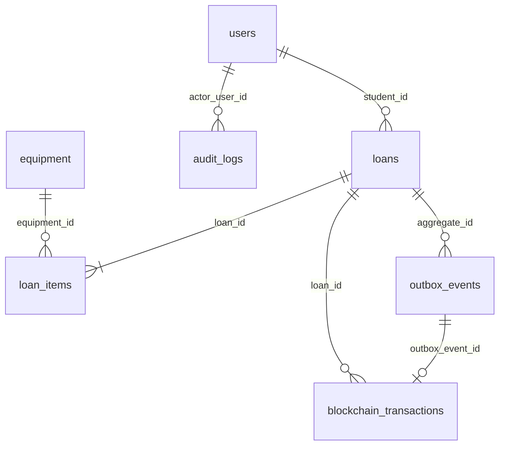

# Database

UUID primary keys; UTC timestamptz; Numeric(12,2) prices. Check constraints enforce nonnegative stock, reserved <= total, positive loan line quantities and valid states. Inventory reserve/release uses conditional SQL updates in the same transaction as loan state, audit and outbox. Lock loans first and inventory in ascending UUID order. Worker uses SKIP LOCKED and a PostgreSQL advisory lock to serialize a shared signer across workers and commits.

Product mapping: ProductID=id, ProductName=name, PathImage=image_path, ProductType=product_type, Quantity=quantity_total, Unit=unit, Price=price, Description=description, CreateDate=created_at, UpdateDate=updated_at. quantity_available is computed from total-reserved; client cannot set reserved/available.

Alembic revisions are explicit, reversible migration files; no runtime create_all. Downgrade drops the affected phase tables: back up data before using it. Tests use a dedicated `*_test` database and truncate only there; they never clear the demo DB.
